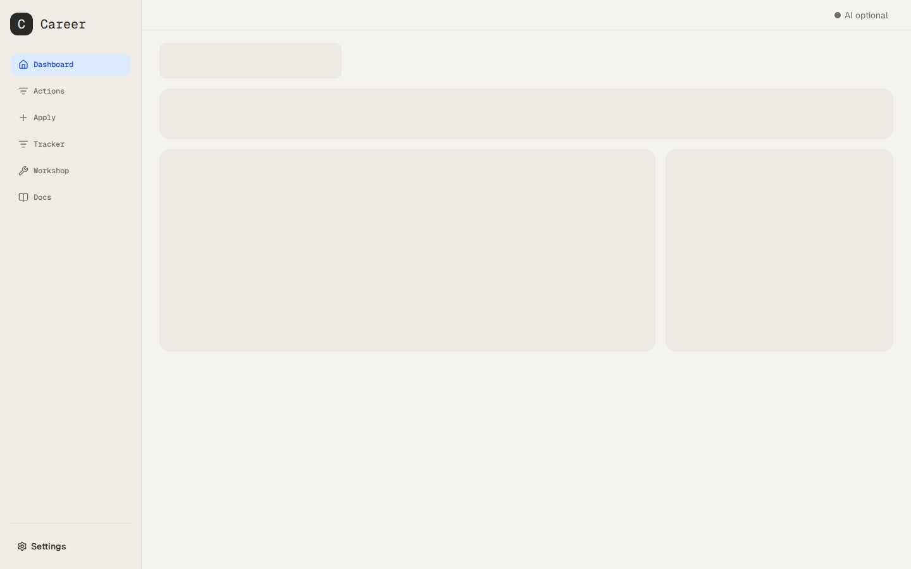
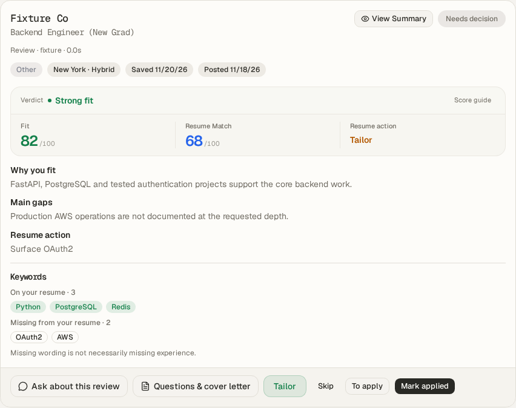
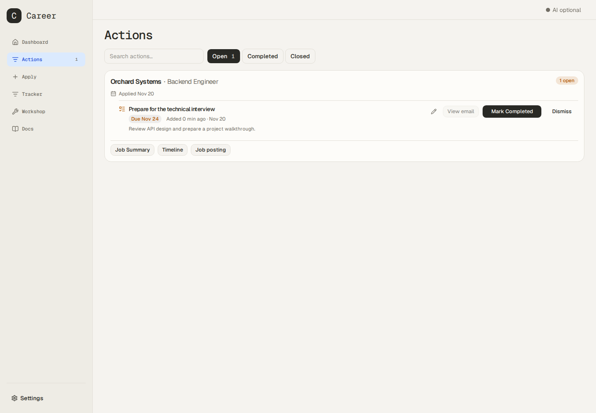
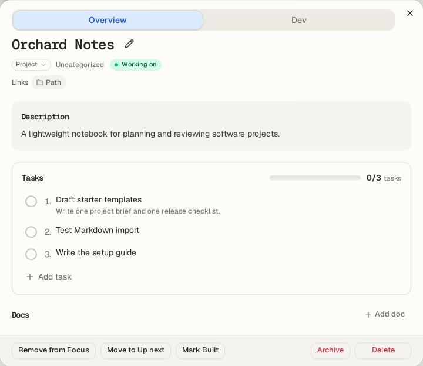
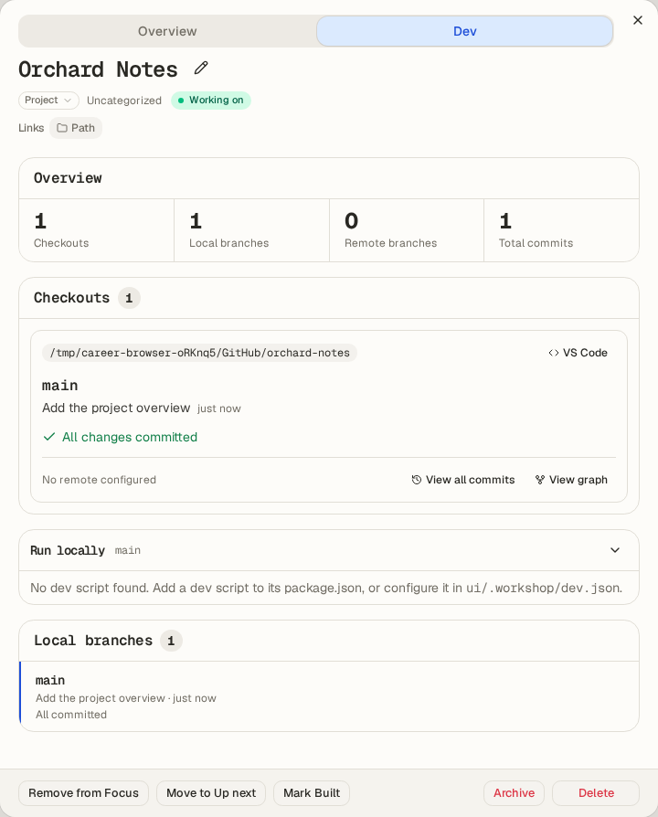

# Career Workspace

A local app for organizing your job search, keeping track of applications and
recruiting tasks, reviewing roles, and saving career notes. Start with an empty
workspace and add your own data.

**[Try the demo](https://career-workspace-demo.vercel.app)** in your browser with fictional data.
No account or install needed.



## Quick start

You need [Git](https://git-scm.com/downloads) and [Node.js 24 or newer](https://nodejs.org)
on Linux, macOS, or Ubuntu in [WSL 2](https://learn.microsoft.com/windows/wsl/install) on Windows.

```sh
npx https://career-workspace-demo.vercel.app/cli.tgz
```

Answer **y** if npm asks to install `create-career-workspace`. The setup then asks
a few questions. Press Enter to skip anything optional.

### What setup does

1. **Downloads and installs** the app into a folder you choose, with an empty workspace.
2. **Adds your background.** Drag in a `.md`, `.txt` or `.pdf` file. A LaTeX resume is optional.
3. **Connects AI.** Choose OpenAI, Claude or none, then API key or subscription, then a model.
4. **Installs resume tools** if you want PDF resumes.
5. **Starts the app** at `http://127.0.0.1:3001`, or the next free port.

Run the same command again to continue where you stopped. Your files are kept.
API keys stay in one private file on your computer.

### What it uses

| Tool | Why | Needed? |
| --- | --- | --- |
| Git, Node.js and npm | Download, install and run the app | Yes |
| OpenAI or Claude | Job reviews, resume tailoring and answers | Optional |
| Python, TeX and Poppler | Build resume PDFs | Optional |
| Claude Code with a Gmail connector | Read-only recruiting email checks | Optional |

### Finish up

Setup can't do these for you:

- **ChatGPT subscription:** in the app, open **Apply → Models → Continue with ChatGPT** and sign in.
- **Your files:** read through `profile/career.md`, remove private details, and put your
  resume in `source/tech/resume.tex`.
- **Email checks:** in Claude, open **Settings → Connectors → Gmail** and sign in. Open the
  app's folder in Claude Code and ask for **Career Check Dry Run**. It saves nothing.
- **Next time:** start the app with `./scripts/ui.sh` from its folder. Stop it with **Ctrl+C**.

## Manual setup

Install Git and Node.js 24 or newer on Linux, macOS, or Ubuntu in Windows
Subsystem for Linux (WSL 2). Run these commands inside the Linux distribution
when using WSL. On Windows, clone under your Linux home directory for faster I/O.

```sh
git clone https://github.com/ericshark/career-workspace.git
cd career-workspace
./scripts/setup.sh
./scripts/ui.sh
```

Open the URL printed in the terminal, normally
[http://127.0.0.1:3001](http://127.0.0.1:3001). The first start builds the app.
Stop it with **Ctrl+C**, or run `./scripts/ui.sh stop` in another terminal.
Use `./scripts/ui.sh status` to see whether the launcher is running. If the port
is occupied, start with a different one, for example `CAREER_PORT=3100 ./scripts/ui.sh`.

Setup creates an empty tracker and copies starter profile and resume files.
Running it again preserves existing files. Tracking, Actions, Workshop, and
Docs work without an AI connection.

## Connect AI

AI is optional. Pick one connection. You can change it later.

### Option 1: OpenAI API key

Uses your OpenAI API account.

1. Create a key in the [OpenAI API platform](https://platform.openai.com/api-keys).
2. From the repository folder, create your private settings file:

   ```sh
   cp -n ui/.env.example ui/.env.local
   chmod 600 ui/.env.local
   ```

3. Open `ui/.env.local` in an editor, set `OPENAI_API_KEY`, and save.
4. Restart the app. Open **Apply → Models** and choose **OpenAI**. Select **Use OpenAI API key** if a ChatGPT plan was active.

### Option 2: Claude API key

Uses your Claude Console account.

1. Create a key in the [Claude Console](https://platform.claude.com/settings/keys).
2. Create `ui/.env.local` as in option 1 and set `ANTHROPIC_API_KEY`.
3. Restart the app. Open **Apply → Models** and choose **Claude**.

### Option 3: ChatGPT plan

Uses your eligible ChatGPT plan and its limits. No key is needed.

1. Open **Apply → Models** and choose **OpenAI → Continue with ChatGPT**.
2. Authorize plan usage in your browser and return to Apply.
3. Reopen **Models** to see which connection is active.

### Keep it working

Keep keys in `ui/.env.local` and restart after changes. If access expires, reconnect. If a model is unavailable,
pick a model your account allows. The app never switches from plan usage to
API billing automatically. You can review or revoke plan permissions from your
ChatGPT settings. [Official ChatGPT sign-in guide](https://developers.openai.com/siwc/token-sharing-open-source)

The original personal workspace used a Codex CLI subscription login and a
Claude Code setup token. This edition uses its own ChatGPT sign-in and Claude
Console API keys. Eligible Claude subscribers can link a Console organization,
[claim API credits](https://platform.claude.com/docs/en/about-claude/api-credits-for-subscribers),
then use a key from that organization. Eligible ChatGPT subscribers can also
[claim OpenAI API credits](https://developers.openai.com/api/docs/guides/chatgpt-api-credits)
and use a project key from the linked organization.

## Add your profile and resume

Review and Tailor judge each job against two files that only you can provide.
Setup creates both as placeholders. They are Git-ignored, so they stay on your
machine and never reach GitHub.

| File | What goes in it | What it drives |
| --- | --- | --- |
| `profile/career.md` | Your background as Markdown: experience, projects, education, skills, and target roles | **Fit** (how well your evidence matches the job), application answers, cover letters, and Tailor |
| `source/tech/resume.tex` | Your resume as LaTeX | **Match** (how well the resume you would send matches the job) |

**Your profile.** Open `profile/career.md` in any editor and replace each
`<!-- … -->` prompt with text under its heading. Write what you did and can
verify: employers and dates, what you personally built, the tools you used, and
real numbers. Leave out anything you cannot back up. The AI is told to use only
these facts and not to invent any. Review and Questions leave out a `Contact`
section if you add one, and Review also skips `Example bullets` and
`Summary Statements`. Tailor sends the whole file, so keep anything private out of it.

**Your resume.** Open `source/tech/resume.tex` and replace each placeholder line
(`Replace this line with…`) inside the existing `\resumeSubheading` and
`\resumeItem` entries. To add a job or project, copy an existing block. Keep the
template's structure so the checks can read it, then build it:

```sh
./scripts/build.sh source/tech/resume.tex --png ui/.cache/png
```

The build must produce exactly one page and an ATS PASS before it writes
`resumes/tech/Resume.pdf`. Open the PNG to check the layout. Review scores
every job against this tech master, and Tailor makes a job-specific copy
without changing it. The `general` and `datacenter` masters in `source/` are
optional extra versions. Resume and PDF tools need Python, TeX Live and Poppler
(see [Resume tools](#resume-tools)).

## Try a job from start to finish

1. **Start on Dashboard.** Check today's count and recruiting updates. You can
   set the timezone and daily or weekly targets in `ui/.env.local` using the
   example settings.
2. **Log a job you already applied to.** In **Apply → Quick Add**, paste a job
   description, optionally add the posting URL, and submit. A fictional
   example is “Backend Engineer at Orchard Systems. Build Python services,
   write integration tests, and improve API reliability.” Quick Add reads the
   text and records the application. It does not submit it to the employer.
   Without AI, add a record from the terminal:

   ```sh
   ./scripts/apps.sh add --company "Orchard Systems" --role "Backend Engineer" --status applied --resume tech
   ```
3. **Manage it in Tracker.** Find the record, open its details, or update the
   status. Use **Undo** immediately after a Quick Add if needed. View activity
   trends on Dashboard.
4. **Review a role before applying.** First add your own information to
   `profile/career.md` and `source/tech/resume.tex`
   ([how](#add-your-profile-and-resume)). Then use **Apply → Review** for Fit
   and Match and **Tailor** for a separate version. Review changed wording and
   the generated PDF before using it. **Apply → Questions** drafts application
   answers and cover letters.
5. **Plan your next steps.** Add an interview or follow-up under **Actions**.
   In **Workshop**, save ideas, turn them into projects, and keep project
   tasks and links together.
6. **Save reference material.** In **Docs**, use **New doc** to type or paste
   Markdown, or **Import file** for a UTF-8 `.md` or `.txt` file or a PDF.
   Search by title. Text notes are editable, and PDFs can be opened or
   downloaded. Imports are copied into your local library.

## A tour of the app

The screenshots show a fictional workspace. Your workspace starts empty.

### Apply: Quick add and Review

**Quick add** takes pasted job descriptions and logs them as applied today, up to
50 per batch. History on the right lists summaries, reviews, jobs to apply to and
jobs in progress.


**Review** scores a job before you apply. **Fit** compares your career profile
with the role, and **Resume Match** compares your resume with it. The card also
shows the verdict, why you fit, the main gaps, whether to use your master resume
or tailor it, and which keywords are on or missing from your resume. From there
you can ask about the review or draft application answers and a cover letter.



### Tracker and Actions

**Tracker** lists every application with search, filters, sorting and status
counts. Change a status in place, or open the review and timeline for a job.


**Actions** collects follow-ups such as assessments and interviews, with due dates,
links to the job summary and timeline, and Mark Completed or Dismiss.



### Workshop

**Workshop** keeps project ideas and projects together. Focus shows what you are
working on now, with task progress and links.


Each project has tasks, docs and links on its **Overview** tab.



The **Dev** tab shows the project's Git status, branches and commits, and can run
its dev server or open it in VS Code. It acts only inside the project's own linked folder.



### Docs

**Docs** is a local library for Markdown notes and PDFs, such as an interview checklist.


## Resume tools

Tracking and Docs need only Node. To build and tailor resumes on Ubuntu or
WSL, install Python, TeX Live and Poppler. On macOS, install Python, Poppler and
a TeX distribution such as MacTeX. Install dependencies with your platform's
package manager.

```sh
# Ubuntu / WSL
sudo apt install python3 texlive-latex-base texlive-latex-recommended lmodern poppler-utils

# macOS with Homebrew; restart your shell after installing MacTeX
brew install python poppler
brew install --cask mactex-no-gui

# Build your edited master and show its ATS result
./scripts/build.sh source/tech/resume.tex --png ui/.cache/png
```

The starter files show the format. Replace their instructional text before
using the PDFs. A tailored resume must pass the one-page and ATS checks.

## Optional Gmail checks

The app has manual recruiting actions, so email is optional. The app itself never
signs in to Gmail. Mail checks run in a desktop agent, such as Claude Code in the
Claude desktop app, that can use this repository's bundled skills, run local
scripts, and reach a Gmail connector.

1. Connect Gmail in your agent. In Claude, open **Settings → Connectors**, choose
   **Gmail**, and sign in with the account that gets your recruiting mail. Choose
   read-only access where your connector offers it.
2. Open your `career-workspace` folder in the agent.
3. Ask it to run **Career Check Dry Run**. It saves nothing. Review the proposed changes.
4. Ask it to run **Career Check**. It updates your local tracker, recruiting history
   and Actions.

You don't need any labels or filters. The checks **only read Gmail**. The skills
forbid labeling, starring, archiving, moving, deleting or sending mail.
**Opportunity Check** researches a selected recruiter message. Everything runs on demand.

## Local data and backups

The tracker and history are in `records/`, your profile in `profile/`,
resume sources and outputs in `source/` and `resumes/`, Workshop in
`ui/.workshop/`, and Docs in `.documents/`. Back up those directories to a
location you control. They're Git-ignored. Keep `ui/.env.local` and
`ui/.cache/chatgpt-*.json` private. When you use AI, the selected provider
receives the inputs needed for the chosen feature. Imported Docs are held
locally and stay out of AI requests.

## Troubleshooting

- **Setup fails** — check `node --version` and rerun setup from the repo root.
- **Tailor can't build a PDF** — check `pdflatex`, `pdfinfo`, `pdftotext`, and
  `pdftoppm` are on your shell's path.
- **AI is optional** — the header indicates whether credentials are configured
  locally. The first model call confirms model access and billing.
- **PDF preview is blank** — use **Open PDF** or **Download PDF**.

MIT licensed. See [LICENSE](LICENSE).
