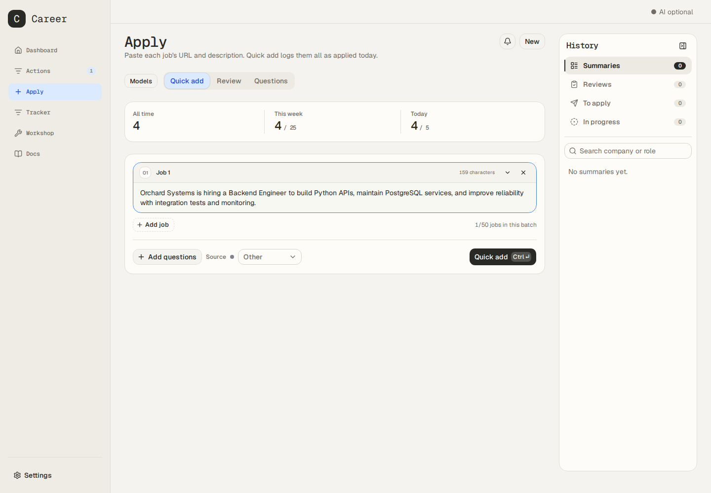
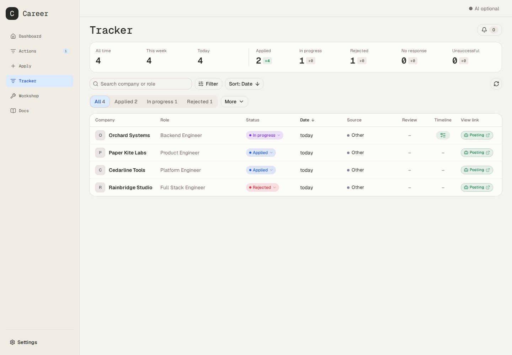
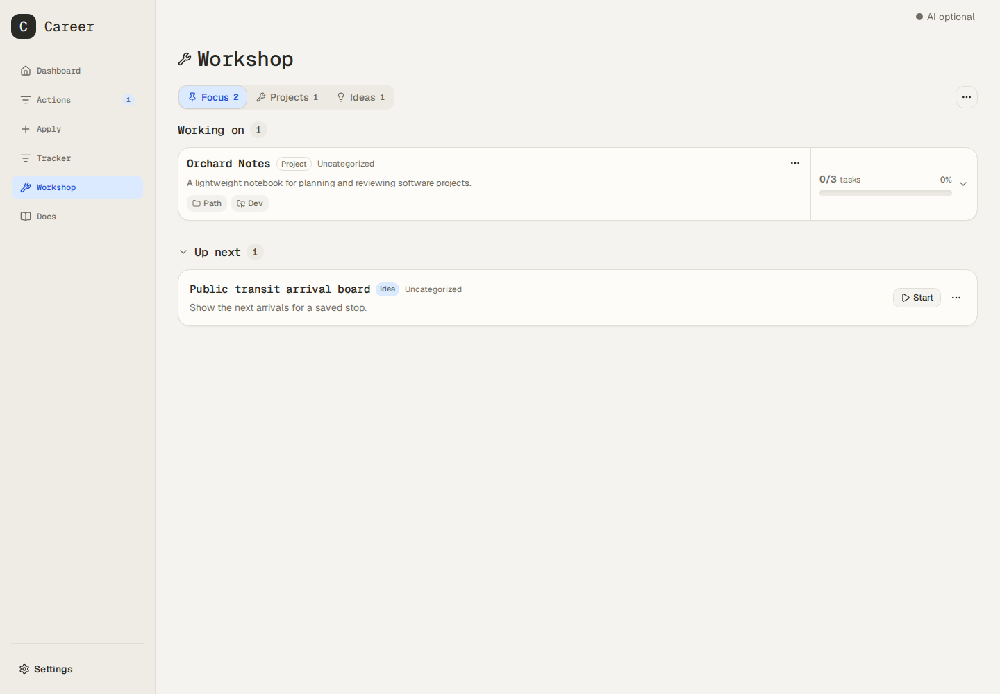
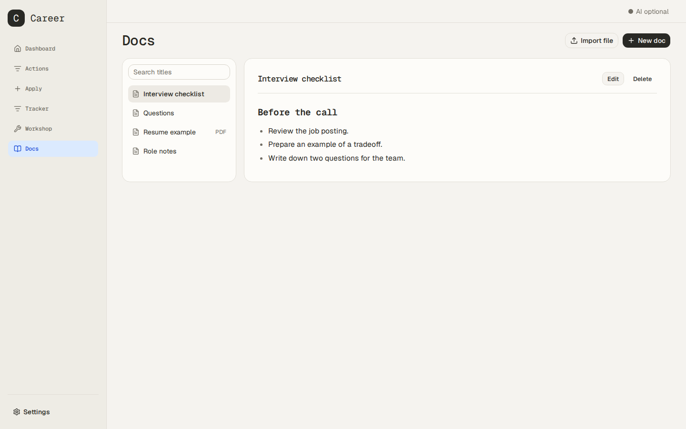

# Career Workspace

A local app for organizing your job search, keeping track of applications and
recruiting tasks, reviewing roles, and saving career notes. Start with an empty
workspace and add your own data.

**[Try the demo](https://career-workspace-demo.vercel.app)** in your browser with fictional data.
No account or install needed.


## Quick start

Use a local agent or run setup yourself. Both paths install the app on your computer.

### Set up with your agent

Copy this prompt into **Codex** or **Claude Code** running on your computer. It runs the official installer, builds and opens the local app, then guides you through your optional profile, resume, AI, Gmail, and shortcut setup.

```text
Set up the public Career Workspace (https://github.com/ericshark/career-workspace) on this computer.

Use a local terminal on macOS, Linux, or Ubuntu in WSL 2. Check for Git, Bash, and Node.js 24 or newer with npm. Reuse the current checkout if it is the public repo, otherwise use ~/career-workspace. Verify the repository before reusing it, and ask for another path if the destination contains unrelated files. For a new or incomplete install, run npx --yes create-career-workspace "<absolute workspace path>" --yes --no-start, replacing the placeholder.

Enter the installed workspace, read .claude/skills/career-workspace-setup/SKILL.md, and follow it now. Verify the app opens first, then guide me through the optional steps. I'll enter any credentials directly in the browser or local settings file.
```

To continue later, open the installed folder in your agent and ask it to run **Career Workspace Setup**.

### Set up manually

Install [Git](https://git-scm.com/downloads) and [Node.js 24 or newer](https://nodejs.org) on Linux, macOS, or Ubuntu in [WSL 2](https://learn.microsoft.com/windows/wsl/install) on Windows. Run setup inside Ubuntu on Windows. Use a folder under your Linux home directory.

```sh
npx create-career-workspace
```

Press Enter if npm asks to install the package. The installer asks where to put the workspace and offers optional profile, AI, and PDF setup. You can skip optional steps and return to them later.

1. Open the address printed in your terminal. The first launch builds the app.
2. [Add your profile and resume](#add-your-profile-and-resume), or start with the empty tracker.
3. For AI features, open **Apply → Models → Continue with ChatGPT** and finish sign-in in your browser, or [configure an API key](#connect-ai). The tracker, Actions, Workshop, and Docs are available with AI skipped.
4. If you want email checks, [connect Gmail in Claude or Codex](#optional-gmail-checks) and run a dry run.
5. [Create a shortcut or start the app again](#reopen-career-workspace), then [try your first job](#try-a-job-from-start-to-finish). See [Troubleshooting](#troubleshooting) if setup stalls.

## Manual setup

If you prefer to clone the repository yourself, run these commands:

```sh
git clone https://github.com/ericshark/career-workspace.git
cd career-workspace
./scripts/setup.sh
./scripts/ui.sh
```

Open the address printed in the terminal, normally [http://127.0.0.1:3001](http://127.0.0.1:3001). Setup creates starter files and preserves your existing files when rerun. If the port is occupied, choose another one, for example `CAREER_PORT=3100 ./scripts/ui.sh`.

## Reopen Career Workspace

From the workspace folder, run:

```sh
node scripts/open-workspace.mjs
```

This starts the server in the background if needed, waits for it to respond, and opens your browser. Bookmark the address it prints. To use another fixed port, add the port number to the end of the command, for example `node scripts/open-workspace.mjs 3100`, and update your bookmark.

- **Windows with WSL 2:** Create a desktop shortcut with a target like `wsl.exe -d Ubuntu -- bash -lc "node '/path/to/career-workspace/scripts/open-workspace.mjs'"`. Set **Run** to **Minimized** in shortcut properties. Use your distro name and installed path.
- **macOS:** Create a shortcut in **Shortcuts** with **Run Shell Script**. Enter `node "/absolute/path/to/career-workspace/scripts/open-workspace.mjs"`, then add the shortcut to the Dock.
- **Linux:** Create an application launcher with a command like `node "/absolute/path/to/career-workspace/scripts/open-workspace.mjs"`. For a desktop entry use `Type=Application` and `Terminal=false`.

If the shortcut cannot find Node, use the absolute path reported by `command -v node` inside the environment where you installed the app. Check the server with `./scripts/ui.sh status` and stop it with `./scripts/ui.sh stop` from the workspace folder.

## Connect AI

AI is optional. Pick one connection. You can change it later.

### Option 1: OpenAI API key

Uses your OpenAI API account.

1. Create a key in the [OpenAI API platform](https://platform.openai.com/api-keys).
2. From the repository folder, create your private settings file:

   ```sh
   cp -n ui/.env.example ui/.env.local
   chmod 600 ui/.env.local
   ```

3. Open `ui/.env.local` in an editor, set `OPENAI_API_KEY`, and save.
4. Restart the app. Open **Apply → Models** and choose **OpenAI**. Select **Use OpenAI API key** if a ChatGPT plan was active.

### Option 2: Claude API key

Uses your Claude Console account.

1. Create a key in the [Claude Console](https://platform.claude.com/settings/keys).
2. Create `ui/.env.local` as in option 1 and set `ANTHROPIC_API_KEY`.
3. Restart the app. Open **Apply → Models** and choose **Claude**.

### Option 3: ChatGPT plan

Uses your eligible ChatGPT plan and its limits. No key is needed.

1. Open **Apply → Models** and choose **OpenAI → Continue with ChatGPT**.
2. Authorize plan usage in your browser and return to Apply.
3. Reopen **Models** to see which connection is active.

### Keep it working

Keep keys in `ui/.env.local` and restart after changes. If access expires, reconnect. If a model is unavailable,
pick a model your account allows. The app never switches from plan usage to
API billing automatically. You can review or revoke plan permissions from your
ChatGPT settings. [Official ChatGPT sign-in guide](https://developers.openai.com/siwc/token-sharing-open-source)

The original personal workspace used a Codex CLI subscription login and a private Claude integration. This edition uses its own ChatGPT sign-in and Claude
Console API keys. Eligible Claude subscribers can link a Console organization,
[claim API credits](https://platform.claude.com/docs/en/about-claude/api-credits-for-subscribers),
then use a key from that organization. Eligible ChatGPT subscribers can also
[claim OpenAI API credits](https://developers.openai.com/api/docs/guides/chatgpt-api-credits)
and use a project key from the linked organization.

## Add your profile and resume

See the [Resume Guide](docs/resume-guide.md) for creating a draft, replacing a master, or restoring a backup.

Review and Tailor judge each job against two files that only you can provide.
Setup creates both as placeholders. They are Git-ignored, so they stay on your
machine and never reach GitHub.

| File | What goes in it | What it drives |
| --- | --- | --- |
| `profile/career.md` | Your background as Markdown: experience, projects, education, skills, and target roles | **Fit** (how well your evidence matches the job), application answers, cover letters, and Tailor |
| `source/tech/resume.tex` | Your resume as LaTeX | **Match** (how well the resume you would send matches the job) |

**Your profile.** Open `profile/career.md` in any editor and replace each
`<!-- … -->` prompt with text under its heading. Write what you did and can
verify: employers and dates, what you personally built, the tools you used, and
real numbers. Leave out anything you cannot back up. The AI is told to use only
these facts and not to invent any. Review and Questions leave out a `Contact`
section if you add one, and Review also skips `Example bullets` and
`Summary Statements`. Tailor sends the whole file, so keep anything private out of it.

**Your resume.** Open `source/tech/resume.tex` and replace each placeholder line
(`Replace this line with…`) inside the existing `\resumeSubheading` and
`\resumeItem` entries. To add a job or project, copy an existing block. Keep the
template's structure so the checks can read it, then build it:

```sh
./scripts/build.sh source/tech/resume.tex --png ui/.cache/png
```

The build must produce exactly one page and an ATS PASS before it writes
`resumes/tech/Resume.pdf`. Open the PNG to check the layout. Review scores
every job against this tech master, and Tailor makes a job-specific copy
without changing it. The `general` and `datacenter` masters in `source/` are
optional extra versions. Resume and PDF tools need Python, TeX Live and Poppler
(see [Resume tools](#resume-tools)).

## Try a job from start to finish

1. **Start on Dashboard.** Check today's count and recruiting updates. You can
   set the timezone and daily or weekly targets in `ui/.env.local` using the
   example settings.
2. **Log a job you already applied to.** In **Apply → Quick Add**, paste a job
   description, optionally add the posting URL, and submit. A fictional
   example is “Backend Engineer at Orchard Systems. Build Python services,
   write integration tests, and improve API reliability.” Quick Add reads the
   text and records the application. It does not submit it to the employer.
   Without AI, add a record from the terminal:

   ```sh
   ./scripts/apps.sh add --company "Orchard Systems" --role "Backend Engineer" --status applied --resume tech
   ```
3. **Manage it in Tracker.** Find the record, open its details, or update the
   status. Use **Undo** immediately after a Quick Add if needed. View activity
   trends on Dashboard.
4. **Review a role before applying.** First add your own information to
   `profile/career.md` and `source/tech/resume.tex`
   ([how](#add-your-profile-and-resume)). Then use **Apply → Review** for Fit
   and Match and **Tailor** for a separate version. Review changed wording and
   the generated PDF before using it. **Apply → Questions** drafts application
   answers and cover letters.
5. **Plan your next steps.** Add an interview or follow-up under **Actions**.
   In **Workshop**, save ideas, turn them into projects, and keep project
   tasks and links together.
6. **Save reference material.** In **Docs**, use **New doc** to type or paste
   Markdown, or **Import file** for a UTF-8 `.md` or `.txt` file or a PDF.
   Search by title. Text notes are editable, and PDFs can be opened or
   downloaded. Imports are copied into your local library.

## A tour of the app

The screenshots show a fictional workspace. Your workspace starts empty.

### Apply: Quick add and Review

**Quick add** takes pasted job descriptions and logs them as applied today, up to
50 per batch. History on the right lists summaries, reviews, jobs to apply to and
jobs in progress.



**Review** scores a job before you apply. **Fit** compares your career profile
with the role, and **Resume Match** compares your resume with it. The card also
shows the verdict, why you fit, the main gaps, whether to use your master resume
or tailor it, and which keywords are on or missing from your resume. From there
you can ask about the review or draft application answers and a cover letter.


### Tracker and Actions

**Tracker** lists every application with search, filters, sorting and status
counts. Change a status in place, or open the review and timeline for a job.



**Actions** collects follow-ups such as assessments and interviews, with due dates,
links to the job summary and timeline, and Mark Completed or Dismiss.


### Workshop

**Workshop** keeps project ideas and projects together. Focus shows what you are
working on now, with task progress and links.



Each project has tasks, docs and links on its **Overview** tab.


The **Dev** tab shows the project's Git status, branches and commits, and can run
its dev server or open it in VS Code. It acts only inside the project's own linked folder.


### Docs

**Docs** is a local library for Markdown notes and PDFs, such as an interview checklist.



## Resume tools

Tracking and Docs need only Node. To build and tailor resumes on Ubuntu or
WSL, install Python, TeX Live and Poppler. On macOS, install Python, Poppler and
a TeX distribution such as MacTeX. Install dependencies with your platform's
package manager.

```sh
# Ubuntu / WSL
sudo apt install python3 texlive-latex-base texlive-latex-recommended lmodern poppler-utils

# macOS with Homebrew; restart your shell after installing MacTeX
brew install python poppler
brew install --cask mactex-no-gui

# Build your edited master and show its ATS result
./scripts/build.sh source/tech/resume.tex --png ui/.cache/png
```

The starter files show the format. Replace their instructional text before
using the PDFs. A tailored resume must pass the one-page and ATS checks.

## Optional Gmail checks

The app has manual recruiting actions, so email is optional. The app itself never
signs in to Gmail. Mail checks run in a desktop agent, such as Claude Code in the
Claude desktop app, that can use this repository's bundled skills, run local
scripts, and reach a Gmail connector.

1. Sign in to your desktop agent and connect your recruiting mailbox.
   - **Claude Desktop:** Open **Customize → Connectors**, choose **Gmail**, and sign in to Google. Open the workspace folder in the **Code** tab.
   - **Codex:** In the ChatGPT desktop app, open **Plugins**, install **Gmail**, and connect your Google account. Open the local workspace folder in Codex and start a new chat there.
2. Ask for **Career Check Dry Run**. Review the proposed application updates and follow-ups without saving them.
3. To apply the proposed updates, ask for **Career Check**. It updates your local tracker, recruiting history, and Actions.

You don't need any labels or filters. The checks **only read Gmail**. The skills
forbid labeling, starring, archiving, moving, deleting or sending mail.
**Opportunity Check** researches a selected recruiter message. Everything runs on demand.

## Local data and backups

The tracker and history are in `records/`, your profile in `profile/`,
resume sources and outputs in `source/` and `resumes/`, Workshop in
`ui/.workshop/`, and Docs in `.documents/`. Back up those directories to a
location you control. They're Git-ignored. Keep `ui/.env.local` and
`ui/.cache/chatgpt-*.json` private. When you use AI, the selected provider
receives the inputs needed for the chosen feature. Imported Docs are held
locally and stay out of AI requests.

## Troubleshooting

- **Setup fails** — check `node --version` and rerun setup from the repo root.
- **Tailor can't build a PDF** — check `pdflatex`, `pdfinfo`, `pdftotext`, and
  `pdftoppm` are on your shell's path.
- **AI is optional** — the header indicates whether credentials are configured
  locally. The first model call confirms model access and billing.
- **PDF preview is blank** — use **Open PDF** or **Download PDF**.

MIT licensed. See [LICENSE](LICENSE).
